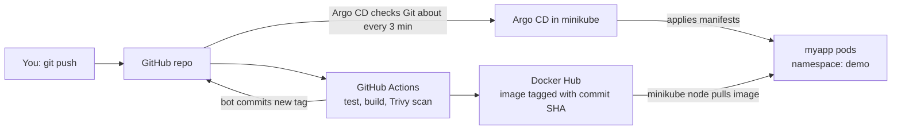

# Local and Minikube GitOps Demo: Python app → Docker → minikube → Argo CD

The same project as the EKS guide, run on your own laptop at zero cloud cost. You will run the app locally, deploy it to minikube by hand, and then run the full GitOps flow: GitHub Actions builds and scans the image, pushes it to Docker Hub, and Argo CD inside minikube deploys it.

---

## Contents

1. [The big picture](#1-the-big-picture)
2. [How to read this guide](#2-how-to-read-this-guide)
3. [What is the same and what changes compared with EKS](#3-what-is-the-same-and-what-changes-compared-with-eks)
4. [Repository layout and files changed in this update](#4-repository-layout-and-files-changed-in-this-update)
5. [Progress checklist](#5-progress-checklist)
6. [Phase 0: Prerequisites and tool installation](#6-phase-0-prerequisites-and-tool-installation)
7. [Phase 1: Run the app locally](#7-phase-1-run-the-app-locally)
8. [Phase 2: Start minikube](#8-phase-2-start-minikube)
9. [Phase 3: Deploy to minikube by hand](#9-phase-3-deploy-to-minikube-by-hand)
10. [Phase 4: The CI pipeline and its output](#10-phase-4-the-ci-pipeline-and-its-output)
11. [Phase 5: Install Argo CD in minikube](#11-phase-5-install-argo-cd-in-minikube)
12. [Phase 6: Connect the app to Argo CD](#12-phase-6-connect-the-app-to-argo-cd)
13. [Phase 7: Practice scenarios](#13-phase-7-practice-scenarios)
14. [Phase 8: Stop, pause or delete](#14-phase-8-stop-pause-or-delete)
15. [Troubleshooting](#15-troubleshooting)
16. [Port and namespace cheat sheet](#16-port-and-namespace-cheat-sheet)
17. [Glossary](#17-glossary)
18. [Reference documentation](#18-reference-documentation)

---

## 1. The big picture



**Three ways to run the project, in increasing realism:**

| Mode | What you do | What it teaches | Phases |
|---|---|---|---|
| **A. Local** | Run the Python app directly and in Docker | The app, tests, the image | 1 |
| **B. Minikube by hand** | Build an image, load it into minikube, apply the manifests with `kubectl` | Kubernetes objects, probes, rollouts, rollbacks | 2, 3 |
| **C. Minikube with GitOps** | `git push` → CI → Docker Hub → Argo CD deploys | The full CI/CD and GitOps path | 4 to 7 |

Do them in order. Each mode builds on the previous one, and each one is a useful interview story.

---

## 2. How to read this guide

Every step is labelled with where you do it:

| Label | Meaning |
|---|---|
| **TERMINAL 1** | Your main Ubuntu terminal, opened in `~/projects/eks-gitops-demo`. |
| **TERMINAL 2** | A second terminal that keeps a long-running command alive (Argo CD port-forward, or the local app). |
| **TERMINAL 3** | A third terminal for the app port-forward. |
| **TERMINAL 4** | A fourth terminal used only for the HPA load test. |
| **BROWSER** | GitHub, Docker Hub, the Argo CD UI, or the minikube dashboard. |
| **AUTOMATIC** | Happens by itself (GitHub Actions or Argo CD). You only watch. |

Each step uses the same template:

- **Where:** which terminal or browser.
- **Run:** the exact commands.
- **What happens:** what the system does behind the scenes.
- **Why it matters:** the significance of the step.
- **Expected result:** what a healthy outcome looks like (your output may differ slightly).
- **Watch it:** a command or screen that lets you see it happen live.

> **Port-forward in one sentence:** `kubectl port-forward` opens a private tunnel from a port on your laptop to a service inside the cluster. It runs until you press `Ctrl+C`, which is why it needs its own terminal.

---

## 3. What is the same and what changes compared with EKS

| Topic | EKS version | Minikube version |
|---|---|---|
| Create the cluster | `eksctl create cluster` (15 to 20 min) | `minikube start` (2 to 5 min) |
| Cost | About $0.15 to $0.20 per hour | Free. It uses your laptop's CPU and RAM |
| Nodes | Managed EC2 node group | One node, running as a Docker container |
| Access | AWS IAM and `aws eks update-kubeconfig` | Local kubeconfig context named `minikube`. No IAM |
| Metrics for HPA | Install metrics-server yourself | `minikube addons enable metrics-server` |
| Getting images | Node pulls from Docker Hub | Node pulls from Docker Hub, or you load a local image with `minikube image load` |
| Teardown | `eksctl delete cluster` (10 to 15 min) | `minikube delete` (seconds) |
| Budget alert, billing checks | Required | Not needed |

**Identical in both:** the app, the Dockerfile, the Kubernetes manifests, the GitHub Actions pipeline, Argo CD and the whole GitOps flow. Nothing in the CI pipeline changes.

**Be honest in interviews:** minikube has no real multi-AZ, no cloud IAM and no cloud load balancer. It is excellent for learning Kubernetes and GitOps, but it is not a production-like environment.

---

## 4. Repository layout and files changed in this update

```
eks-gitops-demo/
├── app/                          # Flask app, tests, Dockerfile            (unchanged)
├── k8s/
│   ├── base/                     # Deployment + Service                    (unchanged)
│   ├── overlays/dev/             # image name/tag updated by CI            (unchanged)
│   └── optional/
│       └── hpa.yaml              # NEW: HorizontalPodAutoscaler for Phase 7
├── argocd/
│   └── application.yaml          # UPDATED: ignores replicas so the HPA and Argo CD don't fight
├── infra/cluster.yaml            # EKS config, not used for minikube       (unchanged)
├── scripts/
│   └── minikube-up.sh            # NEW: starts minikube and enables metrics-server
├── .github/workflows/ci.yml      # Reference version (your existing ci.yml also works)
├── docs/                         # These guides (Markdown and PDF)
└── .gitignore                    # UPDATED: adds .venv/
```

**Minimum changes if you keep your existing repo:**

1. Add `k8s/optional/hpa.yaml` (used only in scenario 7.7).
2. Add the `ignoreDifferences` block and the `RespectIgnoreDifferences=true` option to `argocd/application.yaml`.
3. Add `.venv/` to `.gitignore`.
4. Optional: add `scripts/minikube-up.sh`.

Your existing `ci.yml` needs **no change** for minikube.

---

## 5. Progress checklist

- [ ] Phase 0: Docker, minikube, kubectl, Python venv installed
- [ ] Phase 1: app runs locally, tests pass, Docker image runs
- [ ] Phase 2: minikube running, 1 node Ready, metrics-server enabled
- [ ] Phase 3: app deployed by hand in namespace `local`
- [ ] Phase 4: CI green, image and SHA tag on Docker Hub, overlay updated in Git
- [ ] Phase 5: Argo CD installed and UI reachable
- [ ] Phase 6: app deployed by Argo CD in namespace `demo`
- [ ] Phase 7: practice scenarios done
- [ ] Phase 8: cluster stopped or deleted

**Time estimate:** Phase 0 about 30 min (one time), Phases 1 to 3 about 60 min, Phase 4 about 15 min, Phases 5 and 6 about 25 min, Phase 7 about 60 min.

---

## 6. Phase 0: Prerequisites and tool installation

### Step 0.1: Check your laptop

**Where:** TERMINAL 1

```bash
nproc          # number of CPU cores
free -h        # RAM
df -h ~        # free disk space
```

**Why it matters:** minikube runs a whole Kubernetes cluster plus Argo CD on your laptop. Too little memory is the number one cause of random pod failures later.

**Expected result:** at least 2 CPU cores, 8 GB RAM and 20 GB free disk. Pick your minikube size from this table:

| Laptop RAM | minikube settings | Notes |
|---|---|---|
| 8 GB | `--cpus=2 --memory=4096` | Tight. Close the browser tabs and other heavy apps |
| 16 GB or more | `--cpus=4 --memory=6144` | Comfortable. Use this if `nproc` is 4 or more |

### Step 0.2: Check what is already installed

**Where:** TERMINAL 1

```bash
git --version
docker --version
python3 --version
kubectl version --client
minikube version
```

**Expected result:** a version for each. Install only what is missing using the steps below.

### Step 0.3: Install Docker (if missing)

**Where:** TERMINAL 1

```bash
sudo apt update && sudo apt install -y docker.io
sudo systemctl enable --now docker
sudo usermod -aG docker $USER
newgrp docker
docker run --rm hello-world
```

**What happens:** installs the Docker engine and lets your user run it without `sudo`. minikube will use Docker as the "machine" that hosts the cluster.

**Why it matters:** the Docker driver is the simplest minikube setup on Ubuntu, and you also need Docker to build the image locally.

**Expected result:** "Hello from Docker!". If you see "permission denied", log out and back in, then retry.

### Step 0.4: Install minikube (if missing)

**Where:** TERMINAL 1

```bash
cd /tmp
curl -LO https://github.com/kubernetes/minikube/releases/latest/download/minikube-linux-amd64
sudo install minikube-linux-amd64 /usr/local/bin/minikube
rm minikube-linux-amd64
minikube version
cd ~/projects/eks-gitops-demo
```

**Expected result:** a minikube version number.

### Step 0.5: Install kubectl (if missing)

**Where:** TERMINAL 1

```bash
curl -LO "https://dl.k8s.io/release/$(curl -L -s https://dl.k8s.io/release/stable.txt)/bin/linux/amd64/kubectl"
sudo install -o root -g root -m 0755 kubectl /usr/local/bin/kubectl
kubectl version --client
```

**Note:** keep `kubectl` within one minor version of the cluster. minikube can also provide one with `minikube kubectl --`.

### Step 0.6: Python virtual environment support

**Where:** TERMINAL 1

```bash
sudo apt install -y python3-venv
```

**Why it matters:** a virtual environment keeps the project's Python packages separate from the system ones.

---

## 7. Phase 1: Run the app locally

**Goal:** prove the app and its tests work before involving containers or Kubernetes. If something fails later, you will know the app itself is fine.

### Step 1.1: Get the latest code

**Where:** TERMINAL 1

```bash
cd ~/projects/eks-gitops-demo
git pull
git status
```

**What happens:** downloads any commits made by the CI bot since your last pull.

**Why it matters:** if you edit without pulling, your later `git push` is rejected as "behind".

**Expected result:** "Already up to date" or a list of updated files, and a clean working tree.

### Step 1.2: Create a virtual environment and install dependencies

**Where:** TERMINAL 1

```bash
python3 -m venv .venv
source .venv/bin/activate
pip install -r app/requirements.txt pytest flake8
```

Add `.venv/` to `.gitignore` so it is never committed:

```bash
echo ".venv/" >> .gitignore
```

**Expected result:** your prompt shows `(.venv)` and pip finishes without errors.

### Step 1.3: Lint and test

**Where:** TERMINAL 1

```bash
flake8 app --max-line-length 100
pytest app -q
```

**What happens:** the same two checks the CI pipeline runs.

**Why it matters:** catching a failure here takes seconds. In CI it takes minutes and shows up as a red build.

**Expected result:** `flake8` prints nothing, and pytest prints `2 passed` (or similar).

### Step 1.4: Run the app

**Where:** TERMINAL 2

```bash
cd ~/projects/eks-gitops-demo
source .venv/bin/activate
python app/app.py
```

**Where:** TERMINAL 1

```bash
curl localhost:8080/
curl localhost:8080/health
```

**Expected result:**

```
{"message":"hello from eks-gitops-demo","version":"v1"}
{"status":"ok"}
```

**Watch it:** TERMINAL 2 prints one log line per request. Press `Ctrl+C` in TERMINAL 2 when done.

### Step 1.5: Run it as a Docker container

**Where:** TERMINAL 1

```bash
docker build -t myapp:local app/
docker run -d --name myapp-local -p 8080:8080 myapp:local
curl localhost:8080/health
docker logs myapp-local
docker rm -f myapp-local
```

**What happens:** Docker builds an image from `app/Dockerfile`, starts a container from it, and maps port 8080 to your laptop.

**Why it matters:** this is the exact artifact Kubernetes will run. The image runs the app with `gunicorn` as a non-root user, which is closer to production than `python app.py`.

**Expected result:** `{"status":"ok"}` from the container.

**Port note:** this uses port 8080, the same as the Argo CD UI later. Always stop the local app and container first (`Ctrl+C`, `docker rm -f`).

---

## 8. Phase 2: Start minikube

### Step 2.1: Start the cluster

**Where:** TERMINAL 1

```bash
minikube start --driver=docker --cpus=4 --memory=6144
```

Use `--cpus=2 --memory=4096` on an 8 GB laptop. Or use the helper script, which also enables metrics-server:

```bash
CPUS=4 MEMORY=6144 ./scripts/minikube-up.sh
```

**What happens (2 to 5 minutes the first time):** minikube downloads its base image, starts a Docker container that acts as your Kubernetes node, runs the control plane inside it, and writes a `minikube` context into `~/.kube/config`.

**Why it matters:** this is your whole cluster. Everything after this phase runs inside it.

**Expected result:** the last lines say `Done! kubectl is now configured to use "minikube" cluster`.

**Watch it:** in a second terminal run `docker ps`. You will see a container named `minikube`. That container *is* your node.

### Step 2.2: Verify the cluster

**Where:** TERMINAL 1

```bash
minikube status
kubectl config current-context
kubectl get nodes
kubectl get pods -A
```

**Expected result:**

```
minikube
type: Control Plane
host: Running
kubelet: Running
apiserver: Running
kubeconfig: Configured
```

`kubectl config current-context` prints `minikube`. `kubectl get nodes` shows one node named `minikube` with status `Ready`. `kubectl get pods -A` shows system pods (`coredns`, `kube-proxy`, `etcd`, `kube-apiserver`, and so on) as `Running`.

**If the context is wrong:** `kubectl config use-context minikube`.

### Step 2.3: Enable metrics-server

**Where:** TERMINAL 1

```bash
minikube addons enable metrics-server
# wait about a minute, then:
kubectl top nodes
```

**What happens:** installs metrics-server, which collects CPU and memory usage from the node.

**Why it matters:** the HPA (autoscaler) and `kubectl top` depend on it. Without it, autoscaling cannot work, a classic interview question.

**Expected result:** `kubectl top nodes` prints CPU and memory figures. Until it is ready you may see "Metrics API not available". Wait a minute and retry.

### Step 2.4 (optional): Open the minikube dashboard

**Where:** TERMINAL 2

```bash
minikube dashboard --url
```

**Where:** BROWSER → open the printed URL.

**Why it matters:** a visual overview of namespaces, pods and deployments. Keep it running only while you need it, and press `Ctrl+C` to stop.

---

## 9. Phase 3: Deploy to minikube by hand

**Goal:** learn the Kubernetes objects directly, with no CI and no Argo CD. We use a separate namespace called `local` so this never clashes with the GitOps deployment later (namespace `demo`).

### Step 3.1: Build the image and load it into minikube

**Where:** TERMINAL 1

```bash
docker build -t myapp:v1 app/
minikube image load myapp:v1
minikube image ls | grep myapp
```

**What happens:** the image is built on your laptop's Docker, and `minikube image load` copies it into the minikube node, which has its own separate image store.

**Why it matters:** the node cannot see images in your laptop's Docker by default. Loading avoids pushing to a registry for quick experiments.

**Expected result:** `myapp:v1` appears in the `minikube image ls` output.

### Step 3.2: Create the namespace and apply the manifests

**Where:** TERMINAL 1

```bash
kubectl create namespace local
kubectl apply -n local -k k8s/base
kubectl -n local set image deploy/myapp myapp=myapp:v1
kubectl -n local rollout status deploy/myapp
```

**What happens:** `-k` tells kubectl to build the manifests with Kustomize. The base uses a placeholder image called `myapp`, so `set image` points it at the image you just loaded. A brief `ErrImagePull` before that command is normal.

**Why it matters:** this is the same Deployment and Service that Argo CD will apply later. Here you apply them yourself, so you see every object created.

**Expected result:** `deployment "myapp" successfully rolled out`.

**Watch it:** in TERMINAL 2 run `kubectl -n local get pods -w`. You will see a pod go `ContainerCreating` → `Running`, then `1/1` Ready once the readiness probe passes.

### Step 3.3: Reach the app

**Where:** TERMINAL 3

```bash
kubectl -n local port-forward svc/myapp 8082:80
```

**Where:** TERMINAL 1

```bash
curl localhost:8082/
curl localhost:8082/health
```

**Expected result:** the same JSON as in Phase 1, now served from a pod in minikube.

### Step 3.4: Release a new version by hand

**Where:** TERMINAL 1

```bash
sed -i 's/"v1"/"v2"/' app/app.py
docker build -t myapp:v2 app/
minikube image load myapp:v2
kubectl -n local set image deploy/myapp myapp=myapp:v2
kubectl -n local rollout status deploy/myapp
```

**What happens:** a rolling update. Kubernetes starts a new pod (v2), waits until it is Ready, then removes the old one. With `maxUnavailable: 0` the app is never down.

**Why a new tag:** Kubernetes will not re-pull or restart for the same tag, so each build gets a new tag (this is also why CI uses the commit SHA).

**Expected result:** after restarting the port-forward in TERMINAL 3 (`Ctrl+C`, then run it again), `curl localhost:8082/` shows `"version":"v2"`.

**Watch it:** `kubectl -n local get pods -w` shows the old and new pods overlapping.

### Step 3.5: Break it and fix it

**Where:** TERMINAL 1

```bash
kubectl -n local set image deploy/myapp myapp=myapp:does-not-exist
kubectl -n local get pods
kubectl -n local describe pod -l app=myapp | tail -15
kubectl -n local rollout undo deploy/myapp
kubectl -n local rollout status deploy/myapp
```

**What happens:** the new pod cannot pull the missing image and shows `ErrImagePull` or `ImagePullBackOff`, but the old pod keeps serving. `rollout undo` returns to the last good version.

**Why it matters:** this is the classic debugging path: `get pods` → `describe` → read the events at the bottom → fix or roll back.

**Expected result:** the bad pod is replaced by the previous good one, and the app answers on port 8082 throughout.

### Step 3.6: Clean up Phase 3

**Where:** TERMINAL 1

```bash
git checkout app/app.py              # undo the v2 edit
kubectl delete namespace local       # removes everything created in Phase 3
```

Stop the port-forward in TERMINAL 3 with `Ctrl+C`.

---

## 10. Phase 4: The CI pipeline and its output

The pipeline lives on GitHub and is **identical** for EKS and minikube. This phase confirms it works, because Argo CD needs its output (an image on Docker Hub and an updated tag in Git).

### What the pipeline does (`.github/workflows/ci.yml`)

| Job / step | What it does | Why it matters |
|---|---|---|
| `build-and-test` → lint (flake8) | Checks style and obvious errors | Fast feedback before anything is built |
| `build-and-test` → unit tests (pytest) | Runs `test_app.py` | A failing test stops the pipeline, so nothing is published |
| `build-and-push-docker` → build image locally | Builds the image on the runner (`push: false`, `load: true`) | Gives the scanner an image to inspect before anything is published |
| → Trivy scan | Scans for CRITICAL and HIGH vulnerabilities, fails on findings | A vulnerable image never reaches Docker Hub |
| → log in to Docker Hub | Uses `DOCKERHUB_USERNAME` and `DOCKERHUB_TOKEN` secrets | Logs in only after the scan passes |
| → push image | Pushes `:latest` and `:<commit SHA>` | The SHA tag makes every image traceable to a commit |
| → update image tag in Git | Bot edits `k8s/overlays/dev/kustomization.yaml` and commits | This commit is the signal Argo CD reacts to |

### Step 4.1: Confirm a green run

**Where:** BROWSER

1. GitHub repo → **Actions** → open the latest run on `main` → both jobs should show a green tick.
2. Docker Hub → **Repositories** → `eks-gitops-demo` → **Tags**: you should see `latest` and a 40-character SHA tag.

**Expected result:** all green, and the tags exist.

**If it fails:** open the failed step's log. See [Troubleshooting](#15-troubleshooting).

### Step 4.2: Confirm the manifest was updated and pull it

**Where:** TERMINAL 1

```bash
git pull
cat k8s/overlays/dev/kustomization.yaml
```

**What happens:** brings the bot's commit to your laptop.

**Why it matters:** this file tells Argo CD *which image tag* to run.

**Expected result:**

```yaml
images:
  - name: myapp
    newName: sumitsinghrmga/eks-gitops-demo
    newTag: "<40-character-sha>"
```

The `newTag` must match the SHA tag on Docker Hub. If it still says `latest` or `DOCKERHUB_USER`, the write-back step did not run. Re-check `permissions: contents: write` on that job and the **Workflow permissions** setting (Settings → Actions → General).

### Step 4.3 (optional): Run the published image locally

**Where:** TERMINAL 1

```bash
docker run --rm -p 8080:8080 sumitsinghrmga/eks-gitops-demo:<sha-from-docker-hub>
```

In another terminal: `curl localhost:8080/health`. Stop it with `Ctrl+C`.

**Why it matters:** proves the image on Docker Hub works, independent of Kubernetes.

---

## 11. Phase 5: Install Argo CD in minikube

**What Argo CD is:** a controller that runs inside the cluster, watches a path in a Git repo, and keeps the cluster in sync with it. It also provides a web UI.

### Step 5.1: Install

**Where:** TERMINAL 1

```bash
kubectl create namespace argocd
kubectl apply -n argocd --server-side --force-conflicts \
  -f https://raw.githubusercontent.com/argoproj/argo-cd/stable/manifests/install.yaml
kubectl -n argocd rollout status deploy/argocd-server
```

**What happens:** installs Argo CD's components (API server, repo server, application controller, Redis, and others) into the `argocd` namespace. `--server-side` avoids an "annotation too long" error on its large custom resource definitions.

**Why it matters:** this is the GitOps engine. From here on, deployments come from Git, not from `kubectl apply`.

**Watch it:** in TERMINAL 2 run `kubectl -n argocd get pods -w` and watch the pods start (2 to 4 minutes).

**Expected result:** about 7 pods, all `Running`: `argocd-server`, `argocd-repo-server`, `argocd-application-controller-0`, `argocd-redis`, `argocd-dex-server`, `argocd-notifications-controller`, `argocd-applicationset-controller`.

**If pods stay `Pending` or restart repeatedly:** minikube has too little memory. Run `minikube delete`, then start again with a larger `--memory`.

### Step 5.2: Get the admin password

**Where:** TERMINAL 1

```bash
kubectl -n argocd get secret argocd-initial-admin-secret \
  -o jsonpath="{.data.password}" | base64 -d; echo
```

Copy the output. The username is `admin`.

### Step 5.3: Open the Argo CD UI

**Where:** TERMINAL 2 (stop the `get pods -w` first with `Ctrl+C`)

```bash
kubectl -n argocd port-forward svc/argocd-server 8080:443
```

**Where:** BROWSER → `https://localhost:8080`

Accept the certificate warning (Argo CD uses a self-signed certificate) and log in with `admin` and the password.

**Expected result:** an empty dashboard with a **+ NEW APP** button.

**Why it matters:** the UI makes GitOps visible, and it is good for interview demos.

---

## 12. Phase 6: Connect the app to Argo CD

### Step 6.1: Check and update `argocd/application.yaml`

**Where:** TERMINAL 1

```bash
git pull
cat argocd/application.yaml
```

Make sure it matches this (the `repoURL` must be your repo, and the `ignoreDifferences` block is new in this update):

```yaml
apiVersion: argoproj.io/v1alpha1
kind: Application
metadata:
  name: myapp-dev
  namespace: argocd
spec:
  project: default
  source:
    repoURL: https://github.com/<your-github-username>/eks-gitops-demo.git
    targetRevision: main
    path: k8s/overlays/dev
  destination:
    server: https://kubernetes.default.svc
    namespace: demo
  ignoreDifferences:
    - group: apps
      kind: Deployment
      jsonPointers:
        - /spec/replicas
  syncPolicy:
    automated:
      prune: true
      selfHeal: true
    syncOptions:
      - CreateNamespace=true
      - RespectIgnoreDifferences=true
```

| Field | Meaning |
|---|---|
| `source.repoURL` / `path` | Which repo and folder to watch (`k8s/overlays/dev`) |
| `targetRevision: main` | Track the `main` branch |
| `destination.namespace: demo` | Deploy into the `demo` namespace |
| `ignoreDifferences` on `/spec/replicas` | Lets the autoscaler change the replica count without Argo CD undoing it (used in scenario 7.7) |
| `prune: true` | Delete cluster resources that were removed from Git |
| `selfHeal: true` | Undo manual changes made directly in the cluster |
| `CreateNamespace=true` | Create the `demo` namespace if it is missing |

The repo must be **public** for this setup to work without credentials.

### Step 6.2: Create the Application

**Where:** TERMINAL 1

```bash
kubectl apply -f argocd/application.yaml
kubectl -n argocd get applications
```

**What happens:** you hand Argo CD the instruction "keep this Git path deployed". It clones the repo, builds the Kustomize overlay, and applies the result to the `demo` namespace.

**Why it matters:** this is the last time you deploy with `kubectl`. From now on you commit to Git.

**Expected result:** `myapp-dev   Synced   Healthy` (it may show `OutOfSync` or `Progressing` for the first minute).

**Watch it:** `kubectl -n argocd get applications -w`, and in the **BROWSER** click the `myapp-dev` tile in Argo CD to see the tree: Application → Service and Deployment → ReplicaSet → Pod, with green hearts when healthy.

### Step 6.3: Verify the deployment

**Where:** TERMINAL 1

```bash
kubectl -n demo get pods
kubectl -n demo get deploy myapp -o jsonpath='{.spec.template.spec.containers[0].image}'; echo
```

**Expected result:** one pod `1/1 Running`, and the image printed is `sumitsinghrmga/eks-gitops-demo:<sha>`, the same SHA as on Docker Hub and in the overlay.

**What happens in the background:** the minikube node pulls that image from Docker Hub, which needs internet access and a public Docker Hub repo.

### Step 6.4: Reach the app

**Where:** TERMINAL 3

```bash
kubectl -n demo port-forward svc/myapp 8081:80
```

**Where:** TERMINAL 1

```bash
curl localhost:8081/
curl localhost:8081/health
```

**Expected result:**

```
{"message":"hello from eks-gitops-demo","version":"v1"}
{"status":"ok"}
```

You have now completed the full path: **commit → CI → Trivy → Docker Hub → Git tag update → Argo CD → minikube pod.**

---

## 13. Phase 7: Practice scenarios

Keep TERMINALS 2 and 3 running and run `git pull` before each change. Each scenario is a short interview story.

### 7.1: Ship a new version (happy path)

**Where:** TERMINAL 1

```bash
git pull
sed -i 's/"v1"/"v2"/' app/app.py
git add app/app.py && git commit -m "bump version to v2" && git push
```

**What happens (AUTOMATIC):** Actions runs (about 3 to 5 min including Trivy) → image pushed with the new SHA → bot commits the new tag → Argo CD detects it (within about 3 min) → a new pod replaces the old one with zero downtime.

**Why it matters:** a deployment is just a Git commit, with a full audit trail.

**Expected result:** `curl localhost:8081/` shows `"version":"v2"`. Restart the TERMINAL 3 port-forward first, because the tunnel is tied to the old pod.

**Watch it:** the **Actions** tab on GitHub, then `kubectl -n demo get pods -w`, and the Argo CD UI (click **Refresh** to skip the wait).

### 7.2: The test gate stops a bad change

Edit `app/test_app.py` so an assertion fails, then commit and push.

**What happens:** the `build-and-test` job fails, and `build-and-push-docker` never starts (it depends on it).

**Expected result:** a red cross on the first job, nothing new on Docker Hub, and no new bot commit.

**Why it matters:** broken code can never reach the registry or the cluster. Undo with `git revert HEAD` and push.

### 7.3: The Trivy gate stops a vulnerable image

Change the first line of `app/Dockerfile` to an old base image, for example `FROM python:3.8-slim`, then commit and push.

**What happens:** the image builds, but the Trivy step scans it and exits with an error if it finds fixable CRITICAL or HIGH vulnerabilities. The push step is never reached.

**Expected result:** most likely a table of CVEs in the log and a red build. If it passes, that image simply had no fixable HIGH or CRITICAL findings, so try an older base image.

**Why it matters:** this is "shift-left security", scanning before publishing. Undo with `git revert HEAD` and push.

### 7.4: A bad release is contained

This one changes only a manifest, so it does not need a new image.

**Where:** TERMINAL 1

```bash
git pull
sed -i '/readinessProbe:/,/initialDelaySeconds/ s#/health#/healthz#' k8s/base/deployment.yaml
git diff k8s/base/deployment.yaml      # only the readiness probe path should change
git add -A && git commit -m "break readiness probe" && git push
```

**What happens:** Argo CD applies the change. The new pod starts, but its readiness probe checks a path that doesn't exist, so it never becomes Ready. Because `maxUnavailable: 0`, Kubernetes keeps the old pod serving traffic.

**Expected result:** two pods, the old one `1/1` and the new one `0/1`, and `curl localhost:8081/health` still works.

**Watch it:** `kubectl -n demo get pods -w` and `kubectl -n demo rollout status deploy/myapp --timeout=60s` (this times out, which is the point).

**Why it matters:** readiness probes plus rolling updates protect users from bad releases.

### 7.5: Roll back with Git

**Where:** TERMINAL 1

```bash
git log --oneline -5
git revert <bad-commit-sha>        # the "break readiness probe" commit
git push
```

**What happens:** the revert restores the working manifest, and Argo CD syncs the cluster back.

**Expected result:** a single pod `1/1 Running`, and the app answering normally.

**Why it matters:** rollback is a normal, audited Git operation. Nobody needs cluster access.

### 7.6: Self-heal undoes manual changes

**Where:** TERMINAL 1

```bash
kubectl -n demo delete svc myapp
kubectl -n demo set env deploy/myapp HACKED=true
kubectl -n demo get svc,pods
```

**What happens:** you deleted a resource and changed another directly in the cluster. Argo CD notices that the live state differs from Git and corrects both because `selfHeal: true`.

**Expected result:** within about a minute the Service is back and the `HACKED` variable is gone (a new pod rolls out without it).

**Watch it:** the Argo CD UI briefly shows `OutOfSync` and then `Synced`. In TERMINAL 1, `kubectl -n demo get svc -w` shows the Service reappear.

**Why it matters:** Git stays the single source of truth, and manual drift can't silently persist. Restart the port-forward in TERMINAL 3 if the Service was recreated.

### 7.7: Autoscaling with the HPA

**Where:** TERMINAL 1

```bash
kubectl apply -f argocd/application.yaml       # make sure ignoreDifferences is active
kubectl -n demo apply -f k8s/optional/hpa.yaml
kubectl -n demo get hpa
```

**What happens:** the HPA watches CPU through metrics-server and changes the Deployment's replica count. The `ignoreDifferences` rule stops Argo CD from fighting it. The pod's CPU **request** is 50m, so a target of 50% means "scale up when average usage exceeds about 25m".

**Expected result:** `TARGETS` shows `<unknown>/50%` for up to a minute, then something like `2%/50%`.

**Generate load. Where:** TERMINAL 4

```bash
kubectl -n demo run load --rm -it --restart=Never --image=busybox:1.36 -- \
  /bin/sh -c 'while true; do wget -q -O- http://myapp >/dev/null; done'
```

**Watch it. Where:** TERMINAL 1

```bash
kubectl -n demo get hpa -w
kubectl -n demo get pods -w
```

**Expected result:** CPU climbs above 50%, and replicas increase from 1 up to a maximum of 4 within one to three minutes. Press `Ctrl+C` in TERMINAL 4 to stop the load. About a minute later the replicas scale back down.

**Why it matters:** this demonstrates requests and limits, metrics-server, and why HPA and GitOps need `ignoreDifferences` on replicas. It is also the story behind your resume's HPA bullet.

**Clean up:** `kubectl -n demo delete -f k8s/optional/hpa.yaml`.

### 7.8: Stop and resume the cluster

**Where:** TERMINAL 1

```bash
minikube stop
minikube status
minikube start
kubectl get pods -A
```

**What happens:** `minikube stop` shuts the node down without deleting it. `minikube start` boots the same node, and Kubernetes restarts all pods from saved state.

**Expected result:** after 1 to 3 minutes the `argocd` and `demo` pods are `Running` again, and the Argo CD application is still `Synced`. Port-forwards (TERMINALS 2 and 3) died when the cluster stopped, so start them again.

**Why it matters:** you can pause the lab overnight without losing anything. This is a big advantage over EKS, where you pay while it runs.

---

## 14. Phase 8: Stop, pause or delete

| Goal | Command | Effect |
|---|---|---|
| Pause for later | `minikube stop` | Frees CPU and RAM. Everything is kept and returns on `minikube start` |
| Remove the app only | `kubectl delete -f argocd/application.yaml` | Argo CD removes the `demo` workloads. The cluster stays |
| Wipe the whole cluster | `minikube delete` | Deletes the node and all data. Start fresh with `minikube start` |
| Free disk space | `docker image prune -a` | Removes unused images (they re-download when needed). Use with care |

**Where:** TERMINAL 1 (stop the port-forwards in TERMINALS 2 to 4 first with `Ctrl+C`)

```bash
minikube delete
minikube status          # reports that the profile was not found
docker ps                # the minikube container is gone
```

**Why it matters:** the GitHub repo, workflows, Docker Hub images and these guides are untouched. You can rebuild the whole environment in about 15 minutes.

---

## 15. Troubleshooting

| Symptom | Likely cause | What to do |
|---|---|---|
| `minikube start`: permission denied (Docker) | User not in the `docker` group | `sudo usermod -aG docker $USER`, then log out and in (or `newgrp docker`) |
| `minikube start`: not enough CPUs or memory | Settings exceed the laptop | Lower `--cpus` and `--memory`, or close other applications |
| Argo CD pods `Pending`, `OOMKilled` or restarting | minikube memory too low | `minikube delete`, start with a larger `--memory` |
| `kubectl` talks to the wrong cluster | Wrong context | `kubectl config use-context minikube` |
| `kubectl top` says "Metrics API not available" | metrics-server still starting | Wait 1 to 2 minutes. Check `minikube addons list` |
| HPA `TARGETS` stuck at `<unknown>` | No metrics, or no CPU request on the pod | Wait. Confirm metrics-server is enabled and the Deployment has `resources.requests` |
| Pod `ErrImagePull` / `ImagePullBackOff` | Wrong image name or tag, private repo, or no internet | `kubectl -n demo describe pod`. Compare with Docker Hub tags. Make the repo public |
| Pod `ErrImagePull` in Phase 3 for `myapp:v1` | Image not loaded into minikube | `minikube image load myapp:v1`, then `minikube image ls` |
| Docker Hub pull rate-limit message | Many anonymous pulls from one IP | Wait a few hours, or log in to Docker Hub from the node |
| Argo CD `ComparisonError` / repository not found | Wrong `repoURL`, or the repo is private | Fix the URL. Keep the repo public |
| Application stays `OutOfSync` | Argo CD polls about every 3 minutes | Click **Refresh** in the UI |
| Argo CD fights the HPA over replicas | `ignoreDifferences` missing | Add the block shown in Step 6.1 and re-apply `application.yaml` |
| Browser can't open `https://localhost:8080` | Port-forward stopped, or the port is taken | Restart TERMINAL 2. Check nothing else uses 8080 (`docker ps`) |
| `curl localhost:8081` fails after a deploy | Port-forward tied to the old pod | Stop and restart the TERMINAL 3 command |
| Actions: write-back push rejected | Workflow permissions read-only, or `main` protected | Settings → Actions → General → Workflow permissions → **Read and write**, and add `permissions: contents: write` to the job |
| Actions: Docker login fails | Missing or misnamed secrets | Recreate `DOCKERHUB_USERNAME` and `DOCKERHUB_TOKEN` |
| Actions: Trivy fails the build | Fixable HIGH or CRITICAL findings | Update the base image or dependencies, then re-run |
| `git push` rejected as behind | The bot committed after your last pull | `git pull --rebase`, then push |
| After a laptop reboot nothing works | minikube is stopped | `minikube start`, then restart the port-forwards |

**Useful debugging commands:**

```bash
kubectl -n demo describe pod <pod-name>        # events at the bottom explain most failures
kubectl -n demo logs <pod-name> --previous     # logs from the last crashed container
kubectl -n argocd get applications -o wide
kubectl get events -A --sort-by=.lastTimestamp | tail -20
minikube logs | tail -50
```

---

## 16. Port and namespace cheat sheet

| Port on laptop | What it reaches | Started in |
|---|---|---|
| 8080 | Argo CD UI (`https://localhost:8080`). Also used by the local app in Phase 1, so never run both | TERMINAL 2 |
| 8081 | App deployed by Argo CD (namespace `demo`) | TERMINAL 3 |
| 8082 | App deployed by hand (namespace `local`) | TERMINAL 3 |

| Namespace | Contents |
|---|---|
| `local` | Phase 3 hand-deployed app (deleted at the end of Phase 3) |
| `argocd` | Argo CD components |
| `demo` | The app deployed by Argo CD |
| `kube-system` | Kubernetes system pods and metrics-server |

---

## 17. Glossary

| Term | Plain meaning |
|---|---|
| **minikube** | A tool that runs a small Kubernetes cluster on your laptop |
| **Context** | The cluster `kubectl` is currently talking to |
| **Addon** | An optional minikube component, for example metrics-server |
| **CI** | Automatically test and build code on every change |
| **GitOps** | The live system is automatically kept equal to what Git says |
| **Image** | A packaged, runnable snapshot of the app |
| **Pod** | The smallest runnable unit in Kubernetes |
| **Deployment** | Keeps the desired number of pods running and handles rolling updates |
| **Service** | A stable internal address that routes to the pods |
| **Namespace** | A logical folder inside a cluster |
| **Kustomize overlay** | Per-environment tweaks layered over a shared base |
| **Readiness probe** | A check that decides whether a pod can receive traffic |
| **HPA** | Horizontal Pod Autoscaler: changes the replica count based on load |
| **Sync / drift / self-heal** | Sync applies Git to the cluster, drift is a difference between them, self-heal removes drift |
| **Port-forward** | A temporary private tunnel from your laptop into the cluster |

---

## 18. Reference documentation

Links can move over time. If one breaks, search for the page title.

| Topic | Link |
|---|---|
| minikube: getting started | https://minikube.sigs.k8s.io/docs/start/ |
| minikube: handbook (addons, images, accessing apps) | https://minikube.sigs.k8s.io/docs/handbook/ |
| Docker Engine on Ubuntu | https://docs.docker.com/engine/install/ubuntu/ |
| Install kubectl | https://kubernetes.io/docs/tasks/tools/ |
| kubectl cheat sheet | https://kubernetes.io/docs/reference/kubectl/quick-reference/ |
| Horizontal Pod Autoscaler walkthrough | https://kubernetes.io/docs/tasks/run-application/horizontal-pod-autoscale-walkthrough/ |
| Argo CD: getting started (with screenshots) | https://argo-cd.readthedocs.io/en/stable/getting_started/ |
| Argo CD: diffing and ignoreDifferences | https://argo-cd.readthedocs.io/en/stable/user-guide/diffing/ |
| Kustomize | https://kubectl.docs.kubernetes.io/references/kustomize/ |
| GitHub Actions | https://docs.github.com/en/actions |
| Trivy | https://trivy.dev/ |

> The Argo CD "getting started" page and the minikube handbook include screenshots and terminal output, which are good visual companions to Phases 2, 5 and 6.
